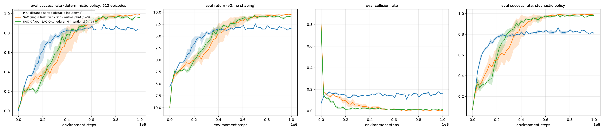

# 项目总结与结论：PPO vs. SAC vs. SAC-X（二维避障导航）

写于 2026-10-01 晚（UTC+8）。文中所有数字都来自真实训练日志：最终运行在 `final/runs_1M/`，开发过程中的运行和诊断在 `archive/v2_dev/`，旧环境的运行在 `archive/v1/`。没有任何外推或编造。凡是"假设/推测"，都单独标明。

---

## 1. 项目概述

任务：在 10×10 的二维世界里，智能体要从随机起点走到随机目标，途中不能碰到 5 个随机障碍物，也不能出界。动作是连续二维向量。我们比较了三种算法：

| 算法 | 类型 | 本项目中的实现 |
|---|---|---|
| **PPO** | on-policy，策略梯度 + clipping + GAE | `SAC/training_PPO.py`，GPU 向量化环境，128 个并行环境 |
| **SAC** | off-policy，最大熵 actor-critic | `SAC/training_SAC.py`（复用 SAC-X 代码，只保留主任务、1 步 TD）：twin critic，自动调节 α |
| **SAC-X** | off-policy，多意图（intention）+ 调度器 + Retrace | `SAC/training_SAC-X.py`：6 个意图（主任务 + 接近目标 + ±x/±y 移动）、共享主干的多头 actor/critic、SAC-Q 调度器、Retrace(λ=1) |

工作分四个阶段：
1. 审查原始代码，找出 bug；
2. 重写 SAC-X，搭建 GPU 环境和 PPO 基线；
3. 设计新环境 v2；
4. 诊断并修复 SAC 的 Q 值高估，最后在 1M 步上比较三种算法。

---

## 2. 最终结果（v2 环境，1M 步，每种算法 3 个 seed）

评估方式：512 个新 episode，确定性策略（tanh(μ) 或均值），回报不含 shaping。

| 算法 | 成功率 @1M（确定性） | 成功率（随机策略） | 评估回报 | 碰撞率 | 成功率 @300k | 成功率 @500k | 每次运行墙钟时间（1M） |
|---|---|---|---|---|---|---|---|
| PPO（排序障碍物输入） | 0.841 ± 0.001 | 0.811 ± 0.009 | 6.58 ± 0.02 | 0.159 ± 0.001 | 0.775 ± 0.024 | 0.844 ± 0.020 | **57 ± 1 s** |
| **SAC** | **0.990 ± 0.003** | **0.995 ± 0.002** | **9.55 ± 0.05** | **0.003 ± 0.001** | 0.479 ± 0.094 | 0.872 ± 0.078 | 约 1190–1270 s（实际训练时间）* |
| **SAC-X（SAC-Q）** | 0.958 ± 0.008 | 0.981 ± 0.007 | 9.02 ± 0.14 | 0.011 ± 0.003 | **0.588 ± 0.081** | 0.864 ± 0.032 | 1367 / 1400 / 1491 s |

\* SAC seed 0 的日志显示 5136 s。原因是电脑在 740k→760k 步之间离线了约 3950 s；扣掉这段，实际训练约 1190 s。另外两个 seed 分别是 1266 s 和 1220 s。所有运行都与用户的游戏共用同一块 GPU，所以时间有波动。

修复前的同一环境（v2）对照：

| | 步数 | 成功率 | 碰撞率 |
|---|---|---|---|
| SAC，修复前 | 200k | 0.081 ± 0.017 | 0.168 |
| SAC-X，修复前 | 250k | 0.026 ± 0.001 | 0.142 |

旧环境（v1，取整网格）对照（[`archive/v1/RESULTS.md`](../archive/v1/RESULTS.md)，曲线见 [`plots/comparison_v1.png`](plots/comparison_v1.png)）：

| | 步数 | 成功率 |
|---|---|---|
| PPO | 1M | 0.446 ± 0.018 |
| 原始"SAC-X"脚本（实为未修复的 SAC） | 80k | 0.028 |
| 修复后的 SAC-X | 250k（1 个 seed） | 0.066 |

### 学习曲线解读
- **前期（≤300k）：PPO 最快。** 300k 时 PPO 0.775，SAC-X 0.588，SAC 0.479。
- **中期（约 500k）：三者持平。** PPO 0.844，SAC 0.872，SAC-X 0.864。
- **后期：PPO 约 500k 起停在 ~0.84，碰撞率一直在 16% 左右；SAC/SAC-X 继续上升，约 700–800k 起停在 0.96–0.99。** SAC 每个 seed 最后 6 次评估（900k–1M）都在 0.97–0.99 之间。三条曲线都已收敛，再训练意义不大。
- **SAC-X 前期领先 SAC，最终略低于 SAC。** 300k：0.59 vs 0.48；1M：0.958 vs 0.990。
- **两种 SAC 的失败方式会变化：先超时，后成功。** 300k 时，SAC/SAC-X 平均 episode 长 34–60 步，大部分失败是超时，不是碰撞；1M 时缩短到约 6 步，与 PPO（约 5 步）相当，基本是"走最短的安全路径"。
- **墙钟时间：PPO 快 20 倍以上。** PPO 跑 1M 约 1 分钟；SAC 约 20 分钟，SAC-X 约 23–25 分钟。如果按"每秒能拿到多少成功率"算，PPO 在 0.84 以下的区间优势巨大；如果按"每个环境样本"或"最终性能"算，SAC 系更好。

---

## 3. GIF：同一组起始状态下三种策略的对比

**使用的模型（都是 1M 步后的最终权重，都是 seed 1）：**
- PPO：`SAC/checkpoints/ppo_sorted_s1_1M.pt`。这是排序输入版 PPO 的 1M 运行；checkpoint 中记录 `features=relative_sorted`、`total_steps=1000000`。
- SAC：`SAC/checkpoints/sac_s1_1M.pt`。原来的权重被覆盖了，这是 2026-10-02 用修复后的保存代码重新训练的，配置和 seed 与原运行完全相同（默认参数，排序障碍物输入）。重训日志 `archive/v2_dev/runs_resave/sac_s1.csv` 的 51 行评估记录（0–1M 步）与原运行 `final/runs_1M/sac_s1.csv` **完全相同**（只有墙钟时间列不同），最终成功率同为 0.994，所以它就是原来那个 1M 模型。重训用时 1105 s（原运行 1266 s）。
- SAC-X：`SAC/checkpoints/sacx_q_s1_1M.pt`。checkpoint 中记录 `tasks=0,1,2,3,4,5`、`total_steps=1000000`，对应 `final/runs_1M/sacx_q_s1.csv`。

**评估设置。** 三个模型都在完全相同的 512 个布局上运行（环境 seed 2026，CPU 上），都采用确定性策略：

| | 到达目标 | 碰撞 | 超时 |
|---|---|---|---|
| PPO | 436 | 76 | 0 |
| **SAC** | **507** | **2** | **3** |
| SAC-X | 490 | 3 | 19 |

- PPO 碰撞、SAC 成功的布局：73 个；PPO 碰撞、SAC-X 成功的布局：65 个；PPO 碰撞、两种 SAC 都成功的布局：63 个；三者都成功的布局：425 个。
- GIF 用的是固定的 4 个布局（索引 298、5、259、0）。前 3 个是"PPO 碰撞、SAC-X 绕行最长"的难例，第 4 个是三者都成功的简单布局，与 10-01 版 GIF 相同，便于直接对比。

**图例：**
- 黑色方块：起点
- 绿色星和半透明圆：目标区域（r=0.5）
- 灰色圆盘：障碍物（r=0.4）
- 彩色线：轨迹（PPO 蓝、SAC 紫、SAC-X 粉）
- 红色 ×：碰撞点

**三栏并排**（左 PPO，中 SAC，右 SAC-X，同一布局）：

| 文件 | PPO | SAC | SAC-X |
|---|---|---|---|
| `gifs/side_by_side_layout1.gif` | 第 2 步碰撞 | 第 7 步到达 | 第 29 步到达 |
| `gifs/side_by_side_layout2.gif` | 第 7 步碰撞 | 第 8 步到达 | 第 23 步到达 |
| `gifs/side_by_side_layout3.gif` | 第 1 步碰撞 | 第 8 步到达 | 第 16 步到达 |

**单算法 2×2 网格**（同样的 4 个布局）：

| 文件 | 4 个布局的结果 |
|---|---|
| `gifs/ppo_4layouts.gif` | 碰撞、碰撞、碰撞、成功 |
| `gifs/sac_4layouts.gif` | 4 个全部成功 |
| `gifs/sacx_4layouts.gif` | 4 个全部成功，分别用 29 / 23 / 16 / 6 步 |

**从 GIF 能直观看到的：**
- **PPO** 几乎只会"朝目标直线前进"，障碍物挡在直线上时直接撞上去。
- **SAC** 走的是一条平滑的弧线，提前绕开障碍物，只多用 1–2 步（7–8 步），几乎就是最短的安全路径。这与它 1M 时 0.99 的成功率、0.3% 的碰撞率一致。
- **SAC-X** 也能绕开障碍物，但在离障碍物很近的地方常常来回"抖动"好几步才找到方向（16–29 步），这在 512 个布局的统计里表现为 19 次超时（SAC 只有 3 次）。这符合 §5.4 中"SAC-X 主任务的最后精细程度略差"的观察；具体原因仍是假设。
- 每个 GIF 都小于 0.5 MB。元数据（模型、布局、结果、步数）在 `gifs/gifs_meta.json`。用下面的命令可以重新生成（只用 CPU，约 1.5 分钟）：
  `cd SAC; python render_gifs.py --sac checkpoints/sac_s1_1M.pt`

---

## 4. 发现并修复的问题（按时间顺序）

### 4.1 "SAC-X" 文件其实不是 SAC-X
原始的 `training_SAC-X.py` 实际上是普通 SAC（SAC v1 架构：V 网络 + 两个 Q 网络），没有意图、调度器，也没有 Retrace。原始文件保存在 `SAC/baseline_original/`。我按论文（Riedmiller et al. 2018）重写了真正的 SAC-X：
- 6 个意图，多头 actor/critic；
- SAC-U / SAC-Q 调度器；
- 带 Retrace 的轨迹回放。

### 4.2 原始 SAC 本身的 bug
- **标准差的处理是错的。** 网络输出被直接当作标准差，再 `clamp(1e-6, 0.5)`，而不是先输出 log σ、再 clamp 到 [-20, 2] 后取 exp。结果是：σ 最大只有 0.5，探索不足；输出一旦落在区间外，梯度就为 0。已在 `model.py` 中改为 log σ 的写法，并修正了 tanh 的 log-prob 修正项。
- **目标网络更新太慢。** 目标网络只在每个 episode 结束时软更新一次（τ=0.005），而不是每个梯度步更新一次。在 episode 很长的情况下，目标网络几乎不动。
- **训练速度太慢。** CPU 上逐步运行 Python 环境，约 35 env-steps/s；GPU 向量化的 PPO 约 30k steps/s。

### 4.3 环境 bug（`environment.py`）
- **没有时间上限。** 原环境没有 time limit，episode 可能无限长。现在加入 100 步截断，并且截断（truncation）与真正的终止（termination）分开处理：截断时仍然 bootstrap。
- **障碍物重叠检查有误。** 障碍物可能与起点、目标或其他障碍物重叠，已修复。
- 动作裁剪、Box 动作空间、checkpoint/history 的重置问题；gym 和 pygame 改为可选依赖。

### 4.4 旧环境（v1）的设计问题：为什么换成 v2
v1 的规则：动作 ×2 后**取整**成网格移动（每轴 -2…2 格）；要**正好落在**目标格才算成功；只检查落点是否碰撞；碰撞奖励为 -50。
- **取整让 SAC 的梯度失效。** SAC 的 actor 更新依赖 ∂Q/∂a（重参数化梯度）。但取整之后，真实的 Q(s,a) 对 a 是**分段常数**：同一个格子里的所有动作效果完全一样。真实梯度几乎处处为 0，critic 学到的平滑梯度纯属拟合假象，actor 会沿着这个虚假梯度去利用 critic 的误差。PPO 只需要 log π(a|s) 的梯度和回报的估计，不需要 ∂Q/∂a，所以受影响小得多。这就是 v1 上 PPO 0.45、SAC/SAC-X < 0.07 的主要原因之一。
- **其他问题。** 均值动作 |a| < 0.25 会被取整成"不动"，所以确定性评估偏悲观；只检查落点，可以"穿过"障碍物；-50 的碰撞惩罚相对 +10 太极端；奖励极度稀疏。

v2 的改动（参考实现：`SAC/torch_env.py::TorchContinuousWorld`）：
- **连续位置。** 动作先裁剪到 [-1,1]²，再裁剪到单位圆，所以每步在各个方向上最多都走 1 格。只用方框裁剪时，tanh 策略会饱和到对角线上。
- **几何定义。** 障碍物和目标都是圆盘；沿整条移动线段检测碰撞，包括出界；目标与碰撞以线段上先发生的事件为准。
- **奖励。** 到达目标 +10，碰撞 -10，每步 -0.05，加上势函数 shaping（Φ = -到目标的距离），100 步截断。
- **一致性检查。** CPU 版 `environment_v2.py` 与 GPU 版逐步对比：float64 下 21,192 个转移，0 处不一致。

v2 上 PPO 从 0.45 提升到 0.83。但 SAC 和 SAC-X 一开始仍然学不会（0.08 / 0.03），这引出了 4.5。

### 4.5 关键 bug：障碍物顺序无关的输入，导致 critic 学不会碰撞
**现象。**
- Q(s0,a0) 约为 10，而同一策略的蒙特卡洛回报约为 0（Q 严重高估）；
- 在人工构造的状态上，Q(撞向障碍物) = +3 … +11，而正确值约为 -10。

**排除的原因**（用 `debug_min_sac.py` 逐项验证）：
- TD 目标和 done/截断的处理都是正确的；
- 去掉障碍物后 SAC 可以学会，Q 值也基本准确，说明 SAC 核心实现没问题；
- LayerNorm、γ=0.95、奖励缩放都只改变高估的幅度，不能解决问题。

**根本原因。**
- 碰撞很少（不到 2% 的转移）；
- 5 个障碍物以**任意顺序**放在 5 个输入槽里，同一种"撞墙悬崖"必须在 5 个槽上分别学一遍，每个槽的数据就更少了；
- MLP critic 会把这个悬崖抹平，actor 恰好找到 critic 过于乐观的区域；
- 1 步 bootstrap 再把这种偏差扩散到整个状态空间（放大约 1/(1−γ) 倍）。

在最小 SAC 里，过高的更新/数据比（每个转移 1 个梯度步）会进一步放大这个问题。

**修复。**
1. **按到智能体的距离对障碍物槽排序**（`--features relative_sorted`）。信息量完全相同，输入维度不变，但输入对障碍物的排列不再敏感：最近的障碍物永远在第 0 槽。
2. **主任务奖励缩放从 0.1 改为 1，初始 α 设为 0.05。** 原来的 0.1 缩放让熵项与整个任务奖励处在同一量级。
3. **适中的 UTD**：8 个环境，每步 1 次 batch=256 的更新。

**消融**（单 seed，300k 步）：

| 设置 | 成功率 |
|---|---|
| 修复前 | 约 0.08 |
| 只排序 | 0.369 |
| 排序 + 奖励缩放 | 0.527 |
| 旧的大批量回放设置 + 修复 | 0.508（说明 UTD 在完整代码中不是决定因素） |

最小 SAC（150k 步）：排序后 0.395，Q 校准良好（5.8 vs MC 6.4）；不排序 0.131（Q 5.1 vs MC 2.0）。

### 4.6 小问题：SAC 和 SAC-X 的 checkpoint 文件名冲突
两者都保存为 `checkpoints/sacx_Q_seed{n}.pt`，后跑的 SAC-X 覆盖了 SAC 的 1M 权重。现在 `training_SAC-X.py` 改为以日志文件名命名 checkpoint：`--log .../sac_s1.csv` 保存为 `checkpoints/sac_s1.pt`，`sacx_q_s1.csv` 保存为 `sacx_q_s1.pt`，`training_SAC.py` 也走同一段代码。不同算法、不同 seed 不会再互相覆盖。`training_PPO.py` 原来保存为 `ppo_seed{n}.pt`，排序版和非排序版会互相覆盖，现在也改为按日志名保存（例如 `ppo_sorted_s1.pt`）。以上只改了代码，没有运行任何训练。

已有的 SAC-X 和 PPO 权重已另存为不会被覆盖的名字（`*_1M.pt`）。2026-10-02 用修复后的代码重新训练了 SAC seed 1 到 1M 步，得到 `checkpoints/sac_s1.pt`，并另存为 `sac_s1_1M.pt`（整理时删除了这个完全相同的 `sac_s1.pt` 副本）。日志 `archive/v2_dev/runs_resave/sac_s1.csv` 与原运行逐行一致（51 行，不计墙钟时间列），最终成功率同为 0.994（随机策略 0.998，碰撞 0.002）。

---

## 5. 对三种算法的理解

### 5.1 On-policy vs off-policy：样本效率 vs 墙钟时间
- **PPO（on-policy）。** 每批数据只用 4 个 epoch 就丢掉，样本效率低。但它在 GPU 上并行 128 个环境，前向/反向都是大批量，没有回放缓冲区，也没有每步一次的小梯度更新，所以墙钟时间极短：1M 步约 1 分钟。在"环境很便宜（GPU 仿真）"的场景下，PPO 的低样本效率几乎不算代价。
- **SAC/SAC-X（off-policy）。** 每个转移会在回放中被重复使用约 32 次。达到同样成功率需要的**环境步数**并不比 PPO 少（前期 PPO 甚至更快），但最终性能高得多。代价是每个环境步都要做梯度更新，墙钟时间约为 PPO 的 20 倍。
- **SAC-X 还要多付出一些。** 多个头、Retrace 需要长度为 8 的序列、CPU 上的调度器逻辑，单位步数比 SAC 慢约 15%。
- **结论。** 如果环境很昂贵（真实机器人），off-policy 的样本复用是决定性优势；如果环境很便宜，PPO 的"快"往往更重要，除非你需要 off-policy 所能达到的最终质量（这里是碰撞率 0.3% vs 16%）。

### 5.2 为什么 PPO 停在"直奔目标"的局部最优（16% 碰撞）
观察到的事实：
- PPO 的 成功率 + 碰撞率 ≈ 1.0，episode 长度约 5 步，**从不超时**；
- 碰撞率从约 300k 起一直是 16–17%；
- 换成排序后的障碍物输入，几乎没有改善（0.159 vs 0.169）。

所以这**不是表示能力的问题**，而是优化/探索的问题。可能的原因：
- **On-policy 加稀有事件。** 只有当前策略实际碰到障碍物，PPO 才能学到"绕开"。随着策略变好，碰撞样本越来越少，梯度信号也越来越弱。旧数据会被丢掉，没有回放可以反复学习这些少见的失败。
- **熵在下降，并且没有熵奖励。** `--ent-coef` 默认为 0，log σ 与状态无关，从 -0.5 降到约 -0.8（熵从 1.84 降到 1.25）。再加上学习率**线性退火到 0**（`--anneal-lr 1`）：到 1M 步时策略实际上已经被冻结。曲线在约 500k 后变平，与此一致。
- **优势归一化（假设）。** 每个 minibatch 内对优势做标准化。碰撞很少时，它们在 minibatch 中是一个小尾巴；"绕路"需要连续几步偏离直线，而每一步偏离的即时优势在 shaping 下是负的（离目标更远了）。因此局部的策略梯度更倾向于"直走 + 偶尔被撞"。这一点**没有做实验验证**。
- **奖励结构。** shaping 的作用是奖励"靠近目标"；只要碰撞惩罚（-10）没有大到超过多次绕路累计的 shaping 损失和时间成本，在约 84% 的布局里直走就是"足够好"的策略。

### 5.3 为什么 SAC 的最大熵 + 回放能学会避障
- **回放保留稀有事件。** 碰撞转移一旦出现就会留在缓冲区里，被反复采样，critic 能学到"障碍物方向 = -10"的悬崖。前提是输入表示让它学得动，这正是 §4.5 中排序的作用。
- **最大熵目标。** 自动调节 α 会把策略熵维持在目标值（−|A|）附近，不会像 PPO 那样随着训练坍缩。策略持续在动作空间中"抖动"，所以障碍物附近的各种动作都会被尝试，critic 在悬崖两侧都有数据。
- **Q 学习本身就是"对每个动作的评估"。** actor 沿 ∂Q/∂a 走，可以精确地"擦着障碍物绕过去"。PPO 则只能依靠整条轨迹回报的高方差估计。
- **代价是前期更慢。** 在 critic 学会避障之前，SAC 表现得很"胆小"：300k 时 episode 长约 45–60 步，大部分失败是超时。之后才逐渐学会走最短的安全路径。

### 5.4 为什么 SAC-X 前期更快、最终略低（下面主要是假设）
**事实。** SAC-X 在 300k 时领先（0.588 vs 0.479，seed 间方差也更小），1M 时略低（0.958 vs 0.990，碰撞 1.1% vs 0.3%）。
- **前期更快（较有把握的解释）。** 辅助意图（接近目标、±x/±y 移动）的奖励是稠密的。共享主干在前期从这些任务中学到了"位置-方向"的表示；调度器执行辅助意图时，也提供了覆盖面更广的探索数据。主任务通过 Retrace 从这些 off-policy 数据中学习。这正是 SAC-X 论文的核心论点。
- **最终略低（假设 1）：调度器的时间开销。** SAC-Q 调度器在整个训练过程中仍会把一部分 episode 片段分给辅助意图，主任务自身的 on-policy 数据占比较少，这对最后精细的避障打磨不利。
- **最终略低（假设 2）：共享主干的干扰。** 6 个头共享同一主干，辅助任务的梯度（例如"一直往 +x 走"）与主任务的精细避障表示可能互相拉扯。
- **最终略低（假设 3）：Retrace 截断。** 当行为策略（辅助意图）与目标策略（主任务）差别很大时，Retrace 的截断系数 c 很小，主任务从辅助数据中得到的有效回报会缩短。
- **未验证。** 以上三条都**没有做消融**。可以这样验证：后期关闭调度器（只执行主任务）；或给主任务一个单独的主干；或比较 SAC-U 与 SAC-Q。

---

## 6. 局限性
- **seed 数少。** 每个设置只有 3 个 seed，消融实验只有 1 个 seed。
- **墙钟时间有噪声。** 训练一直和用户的游戏共用 GPU，SAC seed 0 中间还离线了约 1 小时。
- **PPO 超参数没有调。** 没有为 PPO 调熵系数、学习率退火或碰撞惩罚，所以"PPO 停在 0.84"是**这组超参数下**的结论，不是 PPO 的上限。
- **SAC 的 GIF 模型是重训的。** 原权重被覆盖，GIF 用的是重训模型。重训日志与原运行逐行完全一致，可以认为就是同一个模型。其余 seed（0、2）的 SAC 权重仍然缺失，需要时可以用同样方法重训。
- **环境简单。** 5 个静态障碍物，观测是完整状态，结论能否推广到更复杂的环境（动态障碍物、部分可观测）尚未验证。
- **只验证了 v2。** 在 v1（取整）环境中，我们没有用"排序输入"的修复后版本重新运行 SAC。

## 7. 下一步建议
1. **PPO：** 加熵奖励（`--ent-coef 0.005–0.01`）、关闭学习率退火或设置下限、加大碰撞惩罚（-20…-50）或减弱 shaping，看能否打破 16% 的碰撞平台。
2. **SAC-X：** 做调度器消融：后期只执行主任务，比较 SAC-U 与 SAC-Q，主任务使用独立主干。
3. **样本效率：** 尝试 n-step 回报或 REDQ/DroQ 风格的高 UTD 加正则化，缩短 SAC 前期"胆小"的阶段。
4. **墙钟时间：** 把 SAC-X 的调度器和回放完全移到 GPU 上，用更大批量配合更少的更新步。
5. **表示：** 用置换不变的集合编码器（DeepSets / attention）代替"排序"，以支持数量可变的障碍物。
6. **更难的环境：** 动态障碍物、更多障碍物、局部观测（射线）。

---

## 8. 相关文件
所有路径都相对于 `results/`。

- **最终结果（`final/`）：**
  - `final/CONCLUSIONS.md`：本文
  - `final/plots/`：
    - `comparison_1M.png`：1M 学习曲线
    - `comparison_new_env.png`：300k
    - `comparison_before_fix.png`：修复前
    - `comparison_v1.png`：旧环境
  - `final/gifs/`：6 个 GIF 加 `gifs_meta.json`
  - `final/runs_1M/`：最终的 1M 运行，PPO 排序版、SAC、SAC-X 各 3 个 seed
  - `final/summary_1M.md`：由 `plot_comparison.py` 生成的表格
- **最终模型（`SAC/checkpoints/`）：**
  - `ppo_sorted_s{0,1,2}_1M.pt`
  - `sacx_q_s{0,1,2}_1M.pt`
  - `sac_s1_1M.pt`
- **开发过程存档（`archive/v2_dev/`）：**
  - `RESULTS_new_env.md`：详细诊断（英文）
  - `PROGRESS_NOTES.md`
  - `summary.md`、`summary_before_fix.md`
  - `comparison_new_env_300k.png`
  - `runs_300k/`、`runs_before_fix/`、`runs_ablation/`、`runs_resave/`
  - `diag/`：最小 SAC 诊断
  - `logs/`、`logs_1M/`：控制台输出，含墙钟时间和 `queue.log`
- **旧环境存档（`archive/v1/`）：**
  - `RESULTS.md`、`env_design_comparison.png`、`env_design_table.md`、`summary_table.md`
  - `runs/`、`runs_envdesign/`、`ppo2m.csv`
- **代码：**
  - `SAC/torch_env.py`（GPU 环境、`sort_obstacles_by_distance`）
  - `SAC/environment_v2.py`（CPU 参考实现）
  - `SAC/training_PPO.py`、`SAC/training_SAC.py`、`SAC/training_SAC-X.py`
  - `SAC/debug_min_sac.py`（最小 SAC 加诊断）
  - `SAC/render_gifs.py`（GIF 渲染，只用 CPU，默认输出到 `results/final/gifs/`）
  - `SAC/plot_comparison.py`
  - `SAC/run_queue_new_env.ps1`、`SAC/run_queue_1M.ps1`
