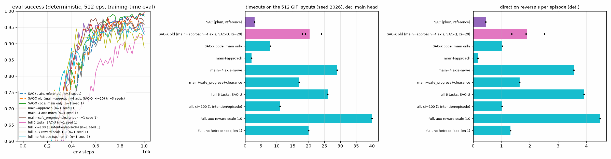

# SAC-X 辅助任务消融：障碍物旁“抖动/来回摆动”问题（2026-10-02）

**背景**：在 512 个固定布局（env seed 2026，与 `render_gifs.py` 相同）上，旧 SAC-X（`sacx_q_s1_1M.pt`）有 19 次超时，SAC 只有 3 次。GIF 中可以看到 SAC-X 在障碍物旁来回摆动。

**评估方式**：
- 所有评估均为 CPU、确定性主任务头（tanh(mu)），另附随机策略对照。
- 指标：goal / collision / timeout、每回合方向反转次数（相邻两步位移夹角 > 90°）、障碍物附近（离障碍表面 < 0.6）的反转、成功回合的路径长度 / 直线距离。

**训练**：
- 消融均为 1M 步、**仅 seed 1**；配置与旧 SAC-X 相同，只改所列项。
- 已启动的 seed 0/2（aux_approach、aux_main、xi=100）在约 800k 步时**被用户停止**，没有保存 checkpoint，只有训练期评估曲线（见第 3 节）。
- 训练期间电脑曾休眠约 1.7 h，CSV 中的 wall_time（约 13.8k s）包含休眠时间，不代表真实耗时。

## 1. 诊断（旧 SAC-X 1M checkpoint）

| 策略（512 布局） | seed 0 | seed 1 | seed 2 |
|---|---|---|---|
| 确定性主头（正常评估） | 489/5/18 | 490/3/19 | 486/2/24 |
| 随机主头（采样） | 505/5/2 | 502/2/8 | 505/3/4 |
| 对 72 个方向取主头 Q 的 argmax | 464/4/44 | 476/4/32 | 480/5/27 |
| 评估时按 SAC-Q 调度执行各意图 | 470/15/27 | 489/7/16 | 485/6/21 |
| SAC s1：确定性 / 随机 / Q-argmax | 507/2/3 | 509/2/1 | 497/6/9 |

结论：
- **“评估时调度器切换意图导致抖动”这一假设不成立。** 评估只使用主任务头；SAC-Q 的调度表与状态无关。若在评估时执行调度，结果反而更差（路径比最高达 13）。
- **抖动来自主任务头本身。** seed 1 的 19 次超时可分两类：
  - 7 次是“停住”：动作约为 0，大多停在离目标 0.56–0.86 处；
  - 12 次是“来回摆动”：每步 0.6–0.9，但几乎没有净位移。
- **原因**：卡住阶段 86% 的状态里，主 Q 在方向上有两个相距 ≥ 45° 的极大值，差值中位数只有 0.09。两条绕行路线几乎等价，确定性策略在两者之间平均（停住）或来回翻转（摆动）。
- **噪声能打破平局**：随机采样后超时从约 20 次降到约 5 次；而直接取 Q 最大方向更差，说明 critic 本身也犹豫不决。
- **卡住并不都在障碍物旁**：只有 16% 的卡住步离障碍物 < 0.6，37% 离障碍物 < 1.0。
- **调度器与辅助头**：调度器在回合开始时有 92% 的概率选主任务；所有时段平均：main 0.45、approach 0.16、各 move 任务 0.09–0.14。障碍物附近，辅助头动作与主头动作的余弦只有约 0.2。

## 2. 消融结果（seed 1，1M 步，512 布局，确定性主头；括号内为随机主头的 timeout）

| 变体 | goal | collision | timeout（随机） | 反转/回合 | 障碍旁反转/回合 | 路径比 |
|---|---|---|---|---|---|---|
| SAC（参考） | 507 | 2 | 3 (1) | 0.45 | 0.05 | 1.21 |
| 旧 SAC-X（main+approach+4×move，SAC-Q，xi=20），3 个 seed 均值 | 488.3 | 3.3 | 20.3 (4.7) | 1.91 | 0.30 | 1.22 |
| 仅 main（SAC-X 代码，含 Retrace） | 502 | 2 | 8 (1) | 1.03 | 0.07 | 1.20 |
| **main + approach** | **506** | 4 | **2 (0)** | **0.17** | 0.08 | 1.19 |
| main + 4×move（轴向移动） | 481 | 2 | 29 (12) | 3.55 | 0.19 | 1.25 |
| main + safe_progress + clearance（新的障碍感知任务） | 494 | 1 | 17 (3) | 1.64 | 0.38 | 1.21 |
| 全部 6 任务，SAC-U | 477 | 9 | 26 (4) | 3.91 | 0.56 | 1.33 |
| 全部 6 任务，xi=100（每回合一个意图） | 495 | 6 | 11 (4) | 1.02 | 0.07 | 1.25 |
| 全部 6 任务，辅助奖励尺度 1.0（原为 0.1） | 468 | 4 | 40 (15) | 4.48 | 1.05 | 1.24 |
| 全部 6 任务，无 Retrace（seq-len 1） | 486 | 6 | 20 (3) | 1.31 | 0.25 | 1.20 |

完整表（含随机 / qmax / sched 各行）见 [eval_table.md](eval_table.md)，图见 [sacx_aux_comparison.png](sacx_aux_comparison.png)，每个 checkpoint 的 JSON 在 `eval/`。

解读（单 seed，需谨慎）：
- **4 个轴向移动任务最有害**：只加它们就有 29 次超时、3.55 次反转/回合。辅助奖励尺度从 0.1 提到 1.0 后更差（40 次），SAC-U（更多时间执行辅助意图）也更差（26 次）。这支持“move ±x/±y 任务把共享主干/策略拉向轴向来回运动”的假设。
- **“靠近目标”（approach）任务不是问题**：main+approach 是最好的变体（2 次超时，反转 0.17/回合，甚至低于 SAC 的 0.45）。“approach 与绕行冲突”这一假设没有得到支持。
- **新的障碍感知任务（safe_progress、clearance）没有解决问题**（17 次超时）。
- **xi=100 好于 xi=20**（11 vs 19），但不如直接去掉 move 任务。
- **去掉 Retrace 没有帮助**（20 次超时）。

## 3. 多 seed 证据（不完整）

seed 0/2 被用户在约 800k 步时停止，只能比较训练期评估（512 个训练评估回合，确定性成功率，800k 步）：

| 变体 | seed 0 | seed 1 | seed 2 | 均值 |
|---|---|---|---|---|
| main + approach | 0.977 | 0.969 | 0.943 | 0.963 |
| 仅 main | 0.959 | 0.980 | 0.979 | 0.973 |
| 全部 6 任务，xi=100 | 0.951 | 0.910 | 0.953 | 0.938 |
| 旧 SAC-X（同 800k 时点） | 0.975 | 0.939 | 0.957 | 0.957 |
| SAC（同 800k 时点） | 0.992 | 0.988 | 0.941 | 0.974 |

在成功率上，main+approach 与旧 SAC-X 的差距落在 seed 噪声范围内。“去掉轴向 move 任务能消除抖动”目前只有 seed 1 的强证据（超时 19→2，反转 1.91→0.17），需要补跑 seed 0/2 到 1M 才能确认。

## 4. GIF（旧 SAC-X | SAC-X main+approach | SAC，确定性主头）

布局选自旧 SAC-X 超时、而 main+approach 到达目标的情况，并按旧 SAC-X 的反转次数排序；超时回合只显示前 60 步。

| GIF | 布局 | 旧 SAC-X | main+approach | SAC |
|---|---|---|---|---|
| [layout400](gifs/sacx_old_vs_new_vs_sac_layout400.gif) | 400 | 超时（100 步） | 第 5 步到达目标 | 第 4 步到达目标 |
| [layout50](gifs/sacx_old_vs_new_vs_sac_layout50.gif) | 50 | 超时（100 步） | 第 6 步到达目标 | 第 5 步到达目标 |
| [layout49](gifs/sacx_old_vs_new_vs_sac_layout49.gif) | 49 | 超时（100 步） | 第 12 步到达目标 | 第 9 步到达目标 |
| [layout225](gifs/sacx_old_vs_new_vs_sac_layout225.gif) | 225 | 超时（100 步） | 第 10 步到达目标 | 第 12 步到达目标 |

每个方法一张 2×2 网格（同样 4 个布局）：[旧 SAC-X](gifs/grid_sacx_old.gif)，[main+approach](gifs/grid_variant.gif)，[SAC](gifs/grid_sac.gif)。元数据见 [gifs/gifs_meta.json](gifs/gifs_meta.json)。

512 布局总计（goal/collision/timeout）：旧 SAC-X 490/3/19，main+approach 506/4/2，SAC 507/2/3。

## 5. 文件
- 代码（`SAC/`）：
  - `training_SAC-X.py`：新增任务 6 safe_progress、7 clearance，以及 `--ckpt-dir`；
  - `torch_env.py`：info 中增加 obstacles；
  - 新脚本：`sacx_aux_eval.py`、`legacy/sacx_aux_diag2.py`、`sacx_aux_report.py`、`render_sacx_aux_gif.py`、`run_sacx_aux.ps1`、`sacx_aux_queue.py`。
- 数据（本目录）：
  - `runs/`：训练 CSV；s0/s2 只到 800k；
  - `checkpoints/`：仅 8 个 s1 checkpoint；
  - `eval/`、`logs/`（含进度日志 `STATUS.md`）、`gifs/`。
