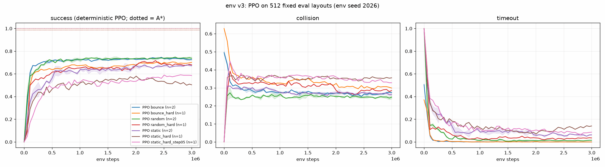

# 环境 v3：连续空间、随机大小/数量的圆形障碍物，可选运动（2026-10-02，已定稿）

v3 只有**一个**核心实现：`SAC/env_v3.py`，基于 torch，在 GPU/CPU 上向量化运行。所有变体都通过 `EnvV3Config` 选择；该 dataclass 可以和 YAML（`configs/*.yaml`）以及 CLI（`--env-<字段名>`、`--env-config`）互相转换。v1/v2（`torch_env.py`）以及 `results/final` 均未改动。

本文件只包含 PPO 验证与 A* 基线；SAC / SAC-X 与模仿学习（BC / DAgger）的对比见 [RESULTS_v3_il_rl.md](RESULTS_v3_il_rl.md)。

## 0. 最终决定（2026-10-02，用户确认）与命名

| 决定 | 结果 |
|---|---|
| 难度 | **主环境 = 原 easy 密度**（n 3–8，r 0.3–0.6，min_gap 0.8）；**原默认密度保留为 hard 档**（n 4–8，r 0.3–0.8，min_gap 0.5） |
| random 模式障碍物数量 | 接受比 static 平均少约 0.5 个（不改） |
| bounce 交互 | elastic（不改） |
| 观测 | 完整观测所有障碍物的位置与速度（65 维，不改） |

**命名（已统一重命名，旧文件见 `results/archive/v3_dev/configs_old_names/`）**：

| 新名称 | 含义 | 旧名称 |
|---|---|---|
| `configs/v3_static.yaml` / `v3_random.yaml` / `v3_bounce.yaml` | 主环境 | `v3_*_easy.yaml` |
| `configs/v3_static_hard.yaml` / `v3_random_hard.yaml` / `v3_bounce_hard.yaml` | hard 档 | 原 `v3_static.yaml` 等 |
| `configs/v3_static_hard_step05.yaml` | hard 档 + max_step 0.5（150 步） | `v3_static_step05.yaml` |

`results/v3/{runs,checkpoints,logs,eval,gifs}` 中的文件已按同样规则改名（`<mode>` = 主环境，`<mode>_hard` = hard 档）。`gifs/gifs_meta.json` 的键和其中的 `config` / `ppo` 路径都已更新为新名称（2026-10-03）；生成 GIF 时实际使用的旧配置文件记录在 `config_at_render_time` 字段中。

## 1. 设计决策

### 1.1 布局采样
场地为 `[0, size]²`（默认 10×10），智能体为点（`agent_radius > 0` 时所有障碍物相应膨胀）。起点、目标和障碍物中心都在连续空间中采样，与网格无关。

- **障碍物数量**：每回合从 `U{n_obs_min..n_obs_max}` 中抽取。
- **障碍物半径**：从 `U[r_min, r_max]` 中抽取。
- **槽位**：固定 `n_obs_max` 个，多余槽位为 padding，mask = 0。

**间距保证**通过向量化拒绝采样实现：每个槽位一次性生成 `sample_tries`（默认 64）个候选，取第一个合法的。保证的条件如下：
- 障碍物之间表面间隙 ≥ `min_gap`；
- 障碍物到墙 ≥ `wall_gap`；
- 障碍物表面到起点 ≥ `start_clear`，到目标中心 ≥ `goal_clear`；
- 起点到目标距离 ≥ `start_goal_min`；
- 起点和目标距墙 ≥ `spawn_margin`。

**不会卡死**：循环次数固定。某个槽位找不到合法候选时直接丢弃（该回合障碍物少一个，计入 `stats["dropped_obstacles"]`）；目标找不到满足距离要求的候选时，取最远的候选（计入 `goal_fallback`）。在一个故意设成不可能满足的配置上（30 个大障碍物），2048 个环境 reset 只用了 0.3 s。

**可行性**：障碍物两两不相交，且都不接触墙（间隙 > 0），因此“正方形减去若干不相交闭圆盘”是道路连通的。起点和目标都在自由空间内，所以**静态快照下一定存在无碰撞路径**；智能体半径 < min(min_gap, wall_gap)/2 时同样成立。
- random 模式：采样时把间距额外加上 2·rw_radius，所以任意时刻间隙都 ≥ min_gap，可行性在每个时刻都成立。
- bounce 模式：障碍物可能短暂接触墙或彼此，**没有路径保证**。
- 实测：在全部 512 个评估布局上，A* 规划失败均为 0（见第 3 节）。

### 1.2 障碍物运动（`motion`）
每个 env step 中障碍物的位移等于其速度 v（dt = 1）。

- **static**：不动。
- **random**：平滑随机速度（OU 过程）：`v ← rw_beta·v + rw_sigma·N(0, I)`，`|v| ≤ speed_max`。
  - 障碍物离出生点不超过 `rw_radius`：越界时把径向速度分量反射，位置投影回该圆上。
  - 由于采样时预留了间距，障碍物永远不会出界、不会覆盖目标，也不会与其他障碍物重叠（单元测试验证）。
- **bounce**：匀速运动，速度大小 ~ `U[speed_min, speed_max]`，方向随机。
  - 撞墙时镜面反射；撞到受保护的目标圆盘（半径 goal_radius + goal_protect）时也反射，所以障碍物永远不会盖住目标。若目标靠墙，投影后沿墙滑动。
  - 障碍物之间按 `obstacle_interaction` 处理：
    - `elastic`（默认）：沿接触法线做弹性碰撞，质量 ∝ r²，重叠部分按对方质量比例推开，动量守恒；
    - `pass`：互相穿过。

### 1.3 智能体与碰撞检测
- **动作**：与 v2 相同，`a ∈ [-1, 1]²` 截断到单位圆，位移 = `max_step · a`（默认 1.0）。
- **碰撞检测**在一步内的分段线性运动下是精确的。设障碍物从 c 移到 c + Δc（Δc 为本步运动和反弹之后的实际位移），智能体从 p 移到 p + d。在障碍物坐标系中，智能体沿 `p − c + t·(d − Δc)`（t ∈ [0, 1]）运动，求它首次进入半径 `r + agent_radius` 圆盘的时刻（相对坐标下的线段–圆求交）。
- 因此下面几种情况都会被正确判定：
  - 智能体静止、被障碍物扫过 → 碰撞；
  - 两条路径在空间上相交但时间上错开 → 无碰撞；
  - 同时到达同一位置 → 碰撞。
- **墙**：线段离开场地即为碰撞。
- **目标**：线段进入目标圆盘即为到达。
- 一步内先发生的事件决定结果。

### 1.4 奖励与观测
**奖励**与 v2 相同：
- 到达目标 +10，碰撞 −10，每步 −0.05；
- 势函数 shaping：`gamma·Φ(s') − Φ(s)`，其中 Φ = −|agent − goal|；
- 到达时间上限时截断，不算终止。
- 评估时的回报不含 shaping。

**观测**为定长向量，维度 `9 + 7·n_obs_max`（n_obs_max = 8 时为 65），各分量大致在 [−1, 1]：
- 智能体位置；
- 目标相对向量、目标距离；
- 到四面墙的距离；
- 每个障碍物槽位（按表面距离排序，padding 排在最后且全为 0）：相对位置、半径 / r_max、速度 / speed_max、表面距离、mask。
- 三种模式的观测维度相同，便于迁移。

### 1.5 A* 基线（`SAC/astar_v3.py`）
A* 使用真实障碍物状态（特权信息）。

- **占据栅格**：分辨率 0.1（100×100）。障碍物按 `r + margin` 膨胀（margin = 0.15）；运动模式下再加 `speed_inflate · |v|`（默认 1 步的运动量）。距墙 < margin 的格子也视为占据。
- **搜索**：8 邻接，代价 0.1 / 0.1·√2，octile 启发式（可采纳且一致，在栅格上最优），禁止切角，open list 用 heapq，g 值存在数组中。
- **旧代码 `SAC/A_star/algorithm.py`（2026-10-03 已移到 `SAC/legacy/v1_original/A_star/`）未复用**：它把值写到了 `child.g` / `child.f`，而不是 `gCost` / `fCost`，导致 g 恒为 0、f 从不更新，实际是贪心搜索而不是 A*；而且只能在整数格上工作。
- **执行**：通过真实 env 执行，动作限制、碰撞和超时的统计方式与 PPO 完全相同。每步朝路径上最远的、直线可见的点移动 min(max_step, 距离)。
- **重规划**：static 模式只在 t = 0 规划一次；运动模式每步按当前障碍物位置重规划。
- **规划失败的回退**：先去掉速度膨胀，再把 margin 设为 0；仍无路径时原地等待，并记为规划失败。
- **一步安全过滤（仅运动模式）**：按匀速预测检查所选动作在下一步是否会碰撞；会碰撞时，从 16 个方向 × 3 种步长 + 等待中选一个预测安全且最接近目标的动作。该预测在 bounce 模式（两次反弹之间）是精确的，在 random 模式是近似的。
- 关闭安全过滤的结果作为对照，存在 `eval/*.json` 的 `astar_nosafety` 键下。

### 1.6 单元测试（`SAC/test_env_v3.py`，CPU 和 CUDA 均**全部通过**）
- **间距保证**：三种模式各 4096 个环境，检查障碍物间隙、墙、起点/目标净空、起终点距离。
- **不可能配置不卡死**：0.3 s 完成，并正确统计 dropped / fallback。
- **静态碰撞**：线段穿过障碍物；擦边（0.31 vs 0.30）不算碰撞；终点在障碍物之后的情况（只检查终点会漏掉）；目标在障碍物之前；撞墙。
- **运动碰撞**：静止智能体被障碍物扫过；路径交叉但时间错开；同时相遇。
- **bounce**：撞墙反射；等质量正碰交换速度且重叠被消除；不等质量时动量守恒；300 步长时间仿真中障碍物不进入目标圆盘、不出界。
- **random**：300 步内不超过 rw_radius、不超过 speed_max、间隙 ≥ min_gap、不覆盖目标。
- **确定性**：相同 seed 完全一致，不同 seed 结果不同。
- **观测**：维度、mask、padding 排在最后、按表面距离排序。

## 2. 配置项（`EnvV3Config`，括号内为默认值 = 主环境）

| 类别 | 字段（默认值） |
|---|---|
| 场地与障碍物 | size (10)，n_obs_min / n_obs_max (3 / 8)，r_min / r_max (0.3 / 0.6)，agent_radius (0) |
| 间距 | min_gap (0.8)，wall_gap (0.5)，start_clear (0.5)，goal_clear (0.8)，start_goal_min (5)，spawn_margin (0.5)，sample_tries (64) |
| 运动 | motion (static)，speed_min / speed_max (0.05 / 0.2)，rw_radius (0.5)，rw_beta (0.8)，rw_sigma (0.08)，obstacle_interaction (elastic)，goal_protect (0.2) |
| 智能体与奖励 | max_step (1.0)，goal_radius (0.5)，goal_value (10)，collision_value (−10)，time_penalty (−0.05)，shaping (1.0)，gamma (0.99)，max_episode_steps (100) |

hard 档只改 n_obs_min 4、r_max 0.8、min_gap 0.5。

使用方式：
- 代码中：`EnvV3(num_envs, EnvV3Config.from_yaml("configs/v3_bounce.yaml"), device="cuda", seed=0)`；
- 命令行：`train_ppo_v3.py --env-config ../configs/v3_static.yaml --env-n-obs-max 6 ...`（CLI 参数覆盖 YAML 中的值）；
- SAC / SAC-X：`training_SAC-X.py --env-version 3 --env-config ../configs/v3_bounce.yaml ...`。

## 3. PPO 验证与 A* 基线

**设置**：
- 512 个固定评估布局（env seed 2026），每种配置一份。
- PPO 使用与 `training_PPO.py` 相同的算法和超参（128 env × 64 步，lr 3e-4，reward × 0.1），每个 run 3M 步。
- 表中为确定性策略的最终值；主环境为 2 个 seed 的均值 ± 标准差，hard 档为 1 个 seed。
- A* 在同样 512 个布局上评估：运动模式开启安全过滤；无安全过滤的结果放在括号里。

| 配置 | PPO seeds | PPO 成功 | PPO 碰撞 | PPO 超时 | PPO 随机策略成功 | PPO 回合长度 | A* 成功 / 碰撞 / 超时（无安全过滤） | A* 规划失败 |
|---|---|---|---|---|---|---|---|---|
| **static**（主） | 2 | **0.674 ± 0.010** | 0.264 ± 0.006 | 0.062 ± 0.004 | 0.704 | 11.7 | 1.000 / 0 / 0 | 0 |
| static_hard | 1 | 0.504 | 0.355 | 0.141 | 0.637 | 18.9 | 1.000 / 0 / 0 | 0 |
| static_hard_step05 | 1 | 0.586 | 0.328 | 0.086 | 0.637 | 23.1 | 1.000 / 0 / 0 | 0 |
| **random**（主） | 2 | **0.737 ± 0.011** | 0.248 ± 0.010 | 0.015 | 0.730 | 9.4 | 0.986 / 0.014 / 0（0.953 / 0.047） | 0 |
| random_hard | 1 | 0.680 | 0.285 | 0.035 | 0.682 | 11.7 | 0.986 / 0.014 / 0（0.936 / 0.064） | 0 |
| **bounce**（主） | 2 | **0.726 ± 0.003** | 0.274 ± 0.003 | 0.000 | 0.709 | 6.9 | 1.000 / 0 / 0（0.922 / 0.078） | 0 |
| bounce_hard | 1 | 0.701 | 0.299 | 0.000 | 0.662 | 8.0 | 0.998 / 0.002 / 0（0.883 / 0.117） | 0 |

- A* 在成功回合中的平均步数约为 6.5（max_step 0.5 时约为 12.7）。
- 512 个布局上，A* 的初始规划失败和逐步规划失败均为 0：所有评估布局都可行，与 1.1 节的连通性保证一致。
- 每次 run 的 wall time 为 10–14 min（3 个并发，GPU）。
- 每回合实际障碍物数量：
  - static / bounce：平均 5.5（主）/ 6.0（hard），无丢弃；
  - random：因预留运动空间，平均约丢弃 0.5 个（主约 5 个，hard 约 5.5 个）；用户已确认接受。

完整表格见 [summary_v3.md](summary_v3.md)，评估 JSON 在 `eval/`，训练日志在 `runs/`。

**解读**：
- 任务**既不平凡也不是不可能**：A* 约 100%，而 PPO 在约 1M 步后停在 0.5–0.74，主要失败模式是碰撞（25–35%）。
- PPO 在 v2 上的上限也只有 0.84，而 SAC 在 v2 上达到 0.99，所以这里的差距大部分来自 PPO 本身，而不是 v3 环境不合理。
- **主环境（较稀疏）**相比 hard 档在三种模式下都把 PPO 成功率提高了 2–17 个百分点。
- **static 对 PPO 反而最难**：超时 6–14%，智能体卡在静态障碍物前的局部极小值里；移动障碍物会打破这种僵局。
- **max_step 0.5** 只略有改善（0.50→0.59），回合变长一倍，不推荐。
- **A* 的安全过滤很重要**：运动模式下没有它会有 5–12% 的碰撞，说明移动障碍物确实增加了难度。

## 4. GIF（上排 PPO（确定性），下排 A*；每张 3 个布局：两个 A* 绕行最多且双方都成功的布局 + 一个 PPO 失败的布局）

| 配置 | 文件 |
|---|---|
| static（主） | [gifs/static_ppo_vs_astar.gif](gifs/static_ppo_vs_astar.gif) |
| static_hard | [gifs/static_hard_ppo_vs_astar.gif](gifs/static_hard_ppo_vs_astar.gif) |
| random（主） | [gifs/random_ppo_vs_astar.gif](gifs/random_ppo_vs_astar.gif) |
| random_hard | [gifs/random_hard_ppo_vs_astar.gif](gifs/random_hard_ppo_vs_astar.gif) |
| bounce（主） | [gifs/bounce_ppo_vs_astar.gif](gifs/bounce_ppo_vs_astar.gif) |
| bounce_hard | [gifs/bounce_hard_ppo_vs_astar.gif](gifs/bounce_hard_ppo_vs_astar.gif) |

每张 GIF 的布局编号、结果和步数见 [gifs/gifs_meta.json](gifs/gifs_meta.json)。

## 5. 最终参数（已确认）

- 主环境：n 3–8，r 0.3–0.6，min_gap 0.8，wall_gap 0.5，start_clear 0.5，goal_clear 0.8，start_goal_min 5；max_step 1.0，goal_radius 0.5，100 步；random 模式 speed_max 0.2、rw_radius 0.5；bounce 模式 speed 0.05–0.2、elastic；完整观测。
- hard 档：n 4–8，r 0.3–0.8，min_gap 0.5，其余相同。
- 下一步（进行中）：A* 示范 + 模仿学习（BC / DAgger）与 SAC / SAC-X / PPO 的对比，见 [RESULTS_v3_il_rl.md](RESULTS_v3_il_rl.md)。

## 6. 文件
- 代码（`SAC/`）：
  - `env_v3.py`：环境；
  - `test_env_v3.py`：单元测试，`python test_env_v3.py [cpu|cuda]`；
  - `astar_v3.py`：A* 基线；
  - `eval_v3.py`：评估 A* / PPO；
  - `train_ppo_v3.py`：PPO 训练；
  - `report_v3.py`：表格与曲线；
  - `render_v3.py`：GIF；
  - `run_v3_ppo.ps1`：后台训练启动脚本；
  - `legacy/rename_v3_levels.py`：一次性改名脚本（easy→主，原默认→hard；已执行，勿再运行）。
  - IL/RL 对比：`il_v3.py`、`run_il_v3.ps1`、`run_v3_rl_queue.py`、`eval_il_rl_v3.py`、`report_il_rl_v3.py`、`render_il_rl_v3.py`。
- 配置：`configs/v3_*.yaml`。
- 结果（`results/v3/`）：`runs/`、`checkpoints/`、`logs/`、`eval/`、`gifs/`、`il/`、`il_rl/`、`ppo_v3_curves.png`、`summary_v3.md`；进度日志 `logs/STATUS.md`。
