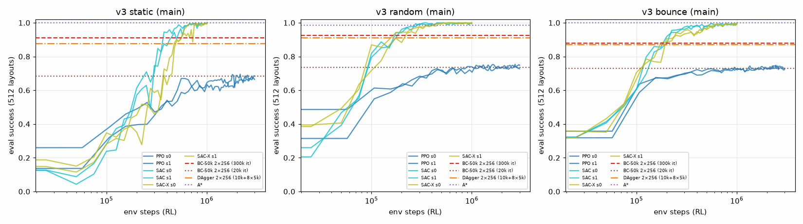
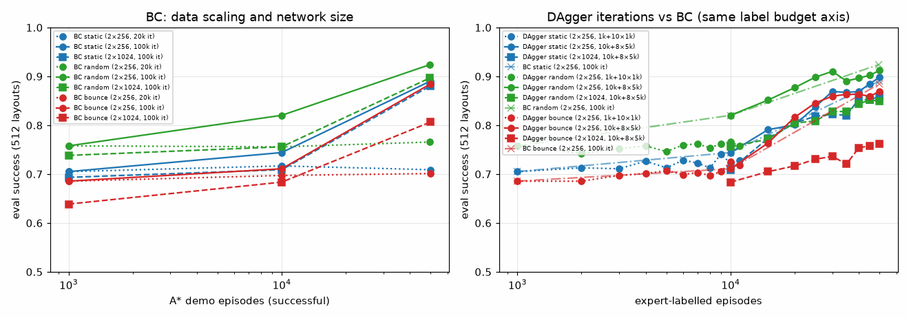

# v3 主环境：模仿学习（BC / DAgger，A* 专家）与强化学习（SAC / SAC-X / PPO）对比 —— **最终结果**（2026-10-03）

> 全部完成：IL（BC / DAgger）和 SAC / SAC-X（每种模式 2 个 seed，1M 步）；PPO 复用已有的 3M 步、2 个 seed。
> 训练曾因用户暂停而中断（2026-10-02 20:56）。被中断的 4 个 run（sac/sacx bounce_s0、static_s1）于 2026-10-03 08:30 从头重新训练；中断前的部分日志（`runs/*.csv.partial`、`logs/*.out.partial`）未参与统计，已在 2026-10-03 目录整理时删除（见 `CLEANUP_LOG.md`）。

## 1. 设置

- **环境**：v3 主环境（`configs/v3_{static,random,bounce}.yaml`，n 3–8，r 0.3–0.6，min_gap 0.8）。观测为 65 维，与 RL 策略使用的完全相同。
- **评估**：512 个固定评估布局（env seed 2026），确定性策略，统一用 `SAC/eval_il_rl_v3.py` 在 **CPU** 上评估，A* 也在同一组布局上评估。
  - **注意**：torch 的 CPU 与 CUDA 随机数生成器即使 seed 相同，生成的序列也不同，所以 "seed 2026 的 512 个布局" 在 CPU 和 GPU 上是**两组不同的布局**。
    - 训练过程中的评估（曲线、`il/*.json` 里的 `eval`、`runs/*.csv`）用的是 CUDA 布局。
    - 本文所有表格用的是 CPU 布局，与 `RESULTS_v3.md` 中 A* 的数字是同一组。
    - 因此 PPO static 在本表中是 0.623（CPU 布局），在 `RESULTS_v3.md` 中是 0.674（CUDA 布局）。两者的差异就是不同布局集之间的抽样差异。
- **路径长度比**：路径长 / A* 路径长，只在该方法和 A* 都成功的布局上计算。
- **示范数据**（`il_v3.py demos`）：
  - 训练布局使用 env seed 100000+batch（每批 1024 个），与评估布局（seed 2026）以及 DAgger 的 rollout 布局（seed 200000+iter）都不重叠。
  - 运动模式下 A* 带一步安全过滤；只保留成功的回合。

| 模式 | 尝试回合 | 保留（成功） | 保留比例 | 丢弃：碰撞 | 丢弃：超时 | (obs, action) 样本数 | 生成耗时 |
|---|---|---|---|---|---|---|---|
| static | 50176 | 50176 | 100.00% | 0 | 0 | 334,734 | 131 s |
| random | 50176 | 49388 | 98.43% | 788 | 0 | 329,226 | 393 s |
| bounce | 50176 | 50165 | 99.98% | 11 | 0 | 335,377 | 411 s |

- **BC**：
  - 网络与 SAC actor 相同（`MultiHeadActor`，2×256 MLP，1 个头）。
  - 损失为 MSE(tanh(μ), a_expert)，Adam 3e-4，batch 1024。
  - 按回合留出 10% 作为验证集，取验证 MSE 最低的权重。
  - 另做了网络宽度 2×1024 的消融。
- **DAgger**：
  - 先在示范数据上做 BC 初始化，然后每轮用当前学习者 rollout，A*（从当前状态重新规划，`replan_always`）给每个访问到的状态重新标注动作。
  - 数据聚合后继续训练（warm start）。
  - 两种规模：
    - 小：1k 示范 + 10 轮 × 1000 回合，每轮 4k 步；
    - 大：10k 示范 + 8 轮 × 5000 回合，总标注量 = 50k 回合，与 BC-50k 相同，每轮 30k 步（2×1024 版本每轮 20k 步）。
- **RL**：
  - SAC 与 SAC-X（消融中最好的变体：主任务 + approach，tasks 0,1，Q 调度器，sorted 障碍物特征）各训练 1M 步。
  - PPO 复用已有的 3M 步、2 个 seed 的模型。
  - 均用 `training_SAC-X.py --env-version 3`（SAC 即 tasks 0）。

## 2. 主结果（v3 主环境，512 个评估布局，CPU 布局集）

- 每个方法只列最好的配置。完整表格（包括 BC 1k/10k、未充分训练的版本、2×1024 消融）见 [il_rl/table_il_rl.md](il_rl/table_il_rl.md)。
- RL 为 2 个 seed 的均值 ± 标准差；IL 为单次训练。
- "路径 / A*" 只在该方法和 A* 都成功的布局上计算。

| 模式 | 方法 | n | 成功 | 碰撞 | 超时 | 路径 / A* | 环境步数 / 样本数 | 专家标注回合 | 耗时 |
|---|---|---|---|---|---|---|---|---|---|
| static | A* | – | 1.000 | 0 | 0 | 1.000 | – | – | 规划器 |
| static | BC-50k（2×256，300k it） | 1 | 0.910 | 0.090 | 0 | 1.005 | 333,570 个专家样本 | 50,000 | 示范 130 s + 训练 659 s |
| static | DAgger（2×256，10k+8×5k） | 1 | 0.875 | 0.125 | 0 | 1.003 | 308,316 个样本 | 50,000 | 1131 s |
| static | PPO（3M） | 2 | 0.623±0.006 | 0.307±0.002 | 0.070±0.004 | 1.015±0.003 | 3.0M 步 | 0 | 12 min/run |
| static | SAC（1M） | 2 | **0.994±0.000** | 0.006±0.000 | 0 | 1.076±0.007 | 1.0M 步 | 0 | 81 min/run |
| static | SAC-X（1M） | 2 | 0.992±0.006 | 0.008±0.006 | 0 | 1.074±0.018 | 1.0M 步 | 0 | 79 min/run |
| random | A* | – | 0.986 | 0.014 | 0 | 1.000 | – | – | 规划器 |
| random | BC-50k（2×256，100k it） | 1 | 0.934 | 0.066 | 0 | 1.001 | 329,226 个专家样本 | 49,388 | 示范 393 s + 训练 202 s |
| random | DAgger（2×256，10k+8×5k） | 1 | 0.912 | 0.088 | 0 | 0.998 | 309,617 个样本 | 50,000 | 1056 s |
| random | PPO（3M） | 2 | 0.735±0.007 | 0.242±0.010 | 0.022±0.003 | 1.086±0.002 | 3.0M 步 | 0 | 12 min/run |
| random | SAC（1M） | 2 | **0.997±0.003** | 0.003±0.003 | 0 | 1.074±0.005 | 1.0M 步 | 0 | 85 min/run |
| random | SAC-X（1M） | 2 | **0.997±0.003** | 0.003±0.003 | 0 | 1.063±0.001 | 1.0M 步 | 0 | 87 min/run |
| bounce | A* | – | 1.000 | 0 | 0 | 1.000 | – | – | 规划器 |
| bounce | BC-50k（2×256，100k / 300k it） | 1 | 0.879 | 0.121 | 0 | 0.998 | 334,283 个专家样本 | 50,000 | 示范 409 s + 训练 227 s |
| bounce | DAgger（2×256，10k+8×5k） | 1 | 0.871 | 0.129 | 0 | 1.001 | 303,640 个样本 | 50,000 | 871 s |
| bounce | PPO（3M） | 2 | 0.698±0.017 | 0.302±0.017 | 0 | 1.009±0.007 | 3.0M 步 | 0 | 13 min/run |
| bounce | SAC（1M） | 2 | **0.996±0.000** | 0.004±0.000 | 0 | 1.123±0.013 | 1.0M 步 | 0 | 66 min/run |
| bounce | SAC-X（1M） | 2 | 0.994±0.000 | 0.006±0.000 | 0 | 1.148±0.012 | 1.0M 步 | 0 | 66 min/run |

**关于耗时**：wall time 都是在多个任务共享一块 RTX 5080 和 16 线程 CPU 的情况下测得的。
- static / random 的 seed 0 与 IL 任务并发，约 100 min/run；
- 后来只有 4 个 RL run 并发时，约 66–85 min/run；
- IL 的耗时同样是在与 RL 并发时测得的。

**RL 样本效率**：首次达到给定确定性成功率时的环境步数。数据来自训练中的评估，每 25k 步评估一次，使用 CUDA 布局集。

| 模式 | SAC ≥0.90 / ≥0.95 / ≥0.98 | SAC-X ≥0.90 / ≥0.95 / ≥0.98 | PPO（3M） |
|---|---|---|---|
| static | s0 450k / 550k / 625k；s1 375k / 425k / 525k | s0 500k / 600k / 650k；s1 550k / 700k / 750k | 从未达到 0.90（最终 0.68 / 0.66） |
| random | s0 175k / 225k / 275k；s1 175k / 200k / 300k | s0 150k / 250k / 350k；s1 175k / 300k / 350k | 从未达到（0.75 / 0.73） |
| bounce | s0 200k / 275k / 325k；s1 225k / 225k / 350k | s0 200k / 425k / 525k；s1 250k / 300k / 550k | 从未达到（0.72 / 0.73） |

（曲线是训练中的评估，用的是 CUDA 布局集；水平线是 IL 和 A* 在 CPU 布局集上的最终评估。）

## 3. Hard 档（零样本：模型都在主环境上训练，直接在 hard 档的 512 个布局上评估）

括号内为路径 / A*。

| 模式 | A* | BC-50k（2×256，300k） | DAgger（2×256，大） | PPO（2 seeds） | SAC（2 seeds） | SAC-X（2 seeds） |
|---|---|---|---|---|---|---|
| static_hard | 1.000 | 0.869（1.008） | 0.873（1.012） | 0.581±0.017（1.017） | **0.987±0.003**（1.086） | 0.979±0.003（1.085） |
| random_hard | 0.986 | 0.904（1.007） | 0.906（1.005） | 0.654±0.004（1.084） | 0.980±0.004（1.087） | **0.992±0.002**（1.085） |
| bounce_hard | 0.998 | 0.852（1.002） | 0.840（1.002） | 0.607±0.006（1.004） | 0.978±0.003（1.158） | **0.983±0.005**（1.218） |

- 2×1024 版本在 hard 档上更差：BC 0.795–0.857，DAgger 0.727–0.805。详见完整表格。
- 从主环境换到 hard 档，各方法的成功率下降幅度：
  - IL：1–4 个百分点；
  - PPO：4–9 个百分点；
  - SAC / SAC-X：0.5–1.8 个百分点。
- 在 hard 档上，SAC / SAC-X 的路径更长，bounce_hard 上比 A* 长 16–22%。

## 4. IL 的数据规模与训练量

（图中的数值是训练过程中在 CUDA 布局集上的评估，趋势与 CPU 表一致。）

BC 成功率（CPU 布局集）：

| 模式 | 1k，20k it | 10k，20k it | 50k，20k it | 10k，100k it | 50k，100k it | 50k，300k it | 50k，2×1024 100k it |
|---|---|---|---|---|---|---|---|
| static | 0.682 | 0.686 | 0.684 | 0.701 | 0.881 | **0.910** | 0.854 |
| random | 0.715 | 0.736 | 0.734 | 0.789 | **0.934** | 0.926 | 0.893 |
| bounce | 0.672 | 0.701 | 0.730 | 0.717 | **0.879** | **0.879** | 0.797 |

DAgger 成功率：

| 模式 | 小（1k + 10×1k = 11k 标注） | 大（10k + 8×5k = 50k 标注） | 大，2×1024 |
|---|---|---|---|
| static | 0.727 | 0.875 | 0.855 |
| random | 0.730 | 0.912 | 0.855 |
| bounce | 0.703 | 0.871 | 0.736 |

## 5. 解读

1. **最初的 BC 结果（约 0.70）主要是欠拟合造成的，而不是数据不够。**
   - 只训练 20k 步时，1k、10k、50k 示范的成功率几乎一样（0.68–0.73），看起来像是"数据规模不起作用"。
   - 同一网络训练到 100k–300k 步后，BC-50k 达到 0.88–0.93。
   - 把网络加宽到 2×1024 反而更差（0.80–0.89），说明不是容量问题，而是优化步数不够。
   - 1k 示范时，验证集最优点出现得很早（100k 步和 20k 步的结果完全相同），即过拟合。
   - 因此 BC 确实受益于数据量：在 2×256、100k 步的设置下，三种模式从 1k 到 10k 到 50k 都单调上升。
2. **BC 的失败几乎全部是碰撞（0 超时），并且集中在少数关键状态。**
   - 诊断（`il/diag_*.json`）：在 static 模式下，让 BC-50k（20k it）自己 rollout，并用 A* 标注每一步：
     - 在所有步上，学习者动作与专家动作的夹角中位数约为 1.2°，L2 误差约 0.06；
     - 在碰撞前的最后一步，夹角中位数为 30°，L2 误差 0.56，并且专家在这一步会减速（|a| 0.74），而学习者仍然全速前进（0.95）。
   - 回合很短（A* 平均约 6.5 步，每步最多走 1.0）。一次在障碍物旁边的不精确动作就会直接导致碰撞，误差没有多步累积的机会。
   - 这与经典的协变量偏移（误差逐步累积、偏离示范分布）不同：这里主要的难点是 A* 策略在障碍物附近**不连续**（绕左还是绕右、在拐角处减速），而 MSE 回归会把这些不连续处平滑掉。
3. **DAgger 修复了"学习者状态分布"的问题，但在同样的标注预算下没有超过充分训练的 BC。**
   - 在大规模设置下，DAgger 的学习者 rollout 成功率随迭代稳步提高（static 0.71 → 0.89，random 0.78 → 0.90，bounce 0.69 → 0.87），说明在学习者自己访问的状态上重新标注确实有效。
   - 但在相同的 50k 标注回合下，最终成功率与 BC-50k（100k it）基本持平或略低：static 0.875 vs 0.881，random 0.912 vs 0.934，bounce 0.871 vs 0.879。
   - 在小预算下，DAgger 相对同样只训练了 20k 步的 BC 略有提升（0.70–0.73 vs 0.68–0.74），差异在噪声范围内。
   - 原因：
     - 失败集中在上面说的不连续点；在 A* 的成功轨迹附近，学习者的状态分布本来就没有偏离太多，所以 DAgger 能带来的增益有限；
     - DAgger 是 warm-start 增量训练，每轮只训练 30k 步，最终模型在聚合数据上的拟合不如从头训练 300k 步的 BC 充分。
   - **结论**：在这个任务上，BC 的主要瓶颈是"把不连续的专家函数拟合精确"，而不是协变量偏移；DAgger 不是决定性的修复手段。
4. **RL 对 IL**：
   - SAC / SAC-X 在 1M 步时达到 0.992–0.997（每种模式 2 个 seed，标准差 ≤ 0.006），比最好的 IL（0.879–0.934）高 6–12 个百分点，比 PPO（0.62–0.74，3M 步）高 25–37 个百分点。
   - 在 hard 档上零样本也几乎不掉（0.978–0.992）。
   - random 和 bounce 上 SAC 在 175k–225k 步就超过了 0.90；static 最慢，要 375k–550k 步。这与 PPO 在 static 上最困难（局部极小值、超时）一致。
   - **路径效率**：SAC / SAC-X 的路径比 A* 长 6–8%（static / random）到 12–15%（bounce）。IL 几乎完全复刻 A* 的路径（比值 0.998–1.005），包括贴着 0.15 的安全边距走。
     - 一个可能的解释是 RL 与障碍物保持更大的距离（碰撞代价 −10 远大于时间代价 −0.05/步），在 bounce 模式下还会绕开运动中的障碍物。这一点未单独测量。
     - 也就是说，RL 学到的是"保守而稳健"的策略，IL 学到的是"高效但精度要求很高"的策略。在这种一次失误就失败的任务里，前者的成功率更高。
   - **SAC-X 与 SAC** 在成功率上没有显著差异（差距 ≤ 0.008，在 seed 噪声范围内）。
     - 在 static 上，SAC-X 达到 0.90 / 0.95 稍慢（500–550k vs 375–450k）；
     - 在 bounce 上路径略长（1.148 vs 1.123）。
     - 在 v2 上，approach 辅助任务的主要作用是消除超时，而 v3 主环境上 SAC 本身已经没有超时，所以这一优势没有体现出来。
   - **代价**：
     - IL 需要 5 万条专家示范（生成 2–7 min），再训练 3–11 min，**不需要任何奖励交互**；
     - SAC 需要 1M 次环境交互，每个 run 66–100 min（与其它任务共享 GPU / CPU 的情况下）；要达到 0.95 也需要 200k–700k 步。
     - 所以 IL 的计算成本约为 SAC 的 1/10 到 1/5，但前提是有一个可以访问真实障碍物状态的专家（A*）；成功率比 SAC 低 6–12 个百分点。
5. **建议**：v3 主环境上以 SAC 为主力方法（SAC-X 可选）。BC 适合作为快速、便宜的基线；如果要进一步提升 IL，比起 DAgger，更有希望的方向是改进对不连续专家的拟合，例如多模态策略、对临近碰撞状态加权，或者在示范中加入噪声。BC 预训练初始化 SAC / PPO（可选项）未做。

## 6. 运行记录

- IL：2026-10-02 18:19–20:28（UTC+8）。
- RL：
  - 第一批（static / random，seed 0）：2026-10-02 18:19–20:08；
  - 中断后剩余的 8 个 run：2026-10-03 08:30–10:42，全部 exit 0。
- 统一评估：2026-10-03 约 10:55。

## 7. GIF（每行一个方法：A* / BC-50k（300k it）/ DAgger（大）/ SAC / SAC-X / PPO（RL 均为 seed 0）；每列一个布局）

- 布局选择：优先选一个 BC 失败而 DAgger 成功、且 A* 绕行明显的布局，另一个选 A* 绕行最多的布局。
- [il_rl/gifs/il_rl_static.gif](il_rl/gifs/il_rl_static.gif)：
  - 布局 29：BC 和 PPO 碰撞，其他方法成功；
  - 布局 39：DAgger 碰撞，其他方法成功（PPO 的结果见 meta）。
- [il_rl/gifs/il_rl_random.gif](il_rl/gifs/il_rl_random.gif)：
  - 布局 142：BC 和 PPO 碰撞；
  - 布局 162：BC 和 DAgger 碰撞，SAC、SAC-X、PPO 成功。
- [il_rl/gifs/il_rl_bounce.gif](il_rl/gifs/il_rl_bounce.gif)：
  - 布局 234：BC 和 PPO 碰撞；
  - 布局 142：DAgger 和 PPO 碰撞。
  - 两个布局上 A*、SAC、SAC-X 都成功。
- 各布局的结果和步数见 `il_rl/gifs/gifs_meta.json`。

## 8. 文件

- 代码（`SAC/`）：
  - `il_v3.py`：demos / bc / dagger / diag；
  - `run_il_v3.ps1`、`run_il_v3_large.ps1`、`run_il_v3_s256.ps1`、`legacy/run_il_static_ablation.ps1`：IL 流水线；
  - `run_v3_rl_queue.py`：RL 队列；
  - `eval_il_rl_v3.py`：统一评估；
  - `report_il_rl_v3.py`：表格与图；
  - `render_il_rl_v3.py`：GIF。
- 结果（`results/v3/`）：
  - `il/`：示范数据（`demos_<mode>.pt`、`_stats.json`），BC / DAgger 的 checkpoint 与 json（包括 DAgger 每轮的历史），`diag_*.json`；
  - `il_rl/`：`eval_<mode>[_hard].json`（逐方法汇总）、`table_il_rl.md`、`il_rl_curves.png`、`il_scaling.png`、`gifs/`；
  - `runs/{sac,sacx}_<mode>_s<seed>.csv`、`checkpoints/`、`logs/`（含进度日志 `STATUS.md`）。
- 中期版本（2026-10-02）：`results/archive/v3_dev/RESULTS_v3_il_rl.interim_2026-10-02.md`。
